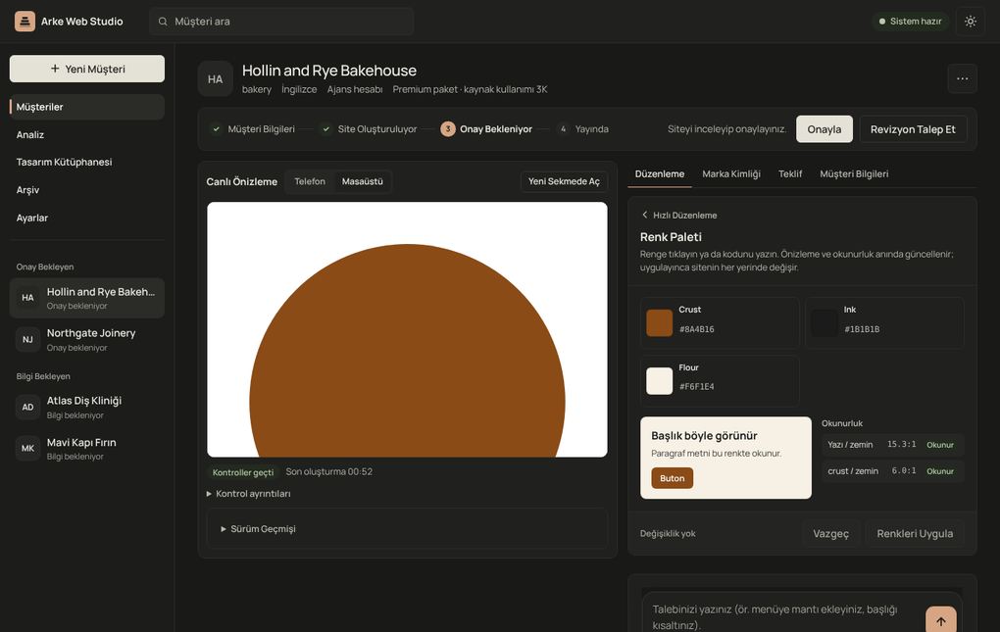
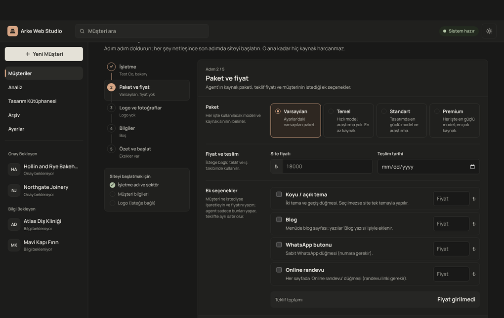
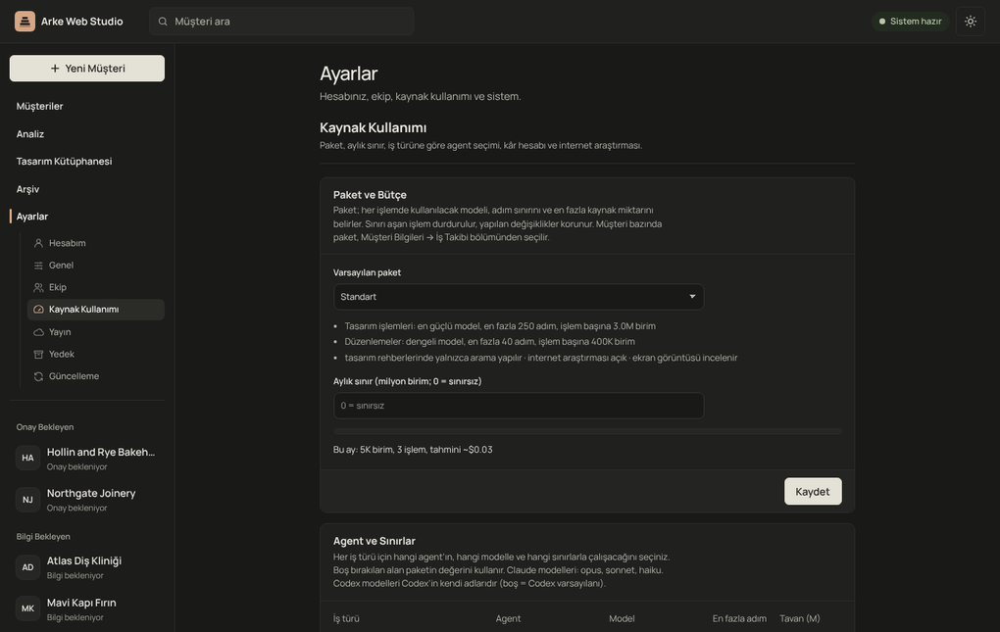
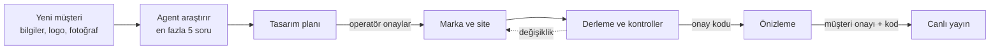

<div align="center">

# Arke Web Studio

**Küçük işletmeler için yapay zekâ destekli web stüdyosu**

Araştırma → tasarım planı → insan onayı → Cloudflare'de yayın


[Hızlı başlangıç](#hızlı-başlangıç) · [Kullanım](#kullanım) · [Nasıl çalışır](#nasıl-çalışır) · [Güvenlik](#güvenlik-modeli) · [Sürüm notları](CHANGELOG.md) · [Yol haritası](ROADMAP.md)



</div>

> **English:** Arke Web Studio is a local control panel plus an MCP server that lets one operator produce, check and
> publish websites for small businesses. An AI agent researches the business and proposes a design plan; nothing is
> built before the operator approves it, nothing is published without a human approval code. Sites run on the
> operator's own Cloudflare account. Proprietary software; see [License](#lisans).

---

## İçindekiler

- [Neler yapar](#neler-yapar)
- [Ekran görüntüleri](#ekran-görüntüleri)
- [Hızlı başlangıç](#hızlı-başlangıç)
- [Nasıl çalışır](#nasıl-çalışır)
- [Kullanım](#kullanım)
- [Site türleri ve hazır parçalar](#site-türleri-ve-hazır-parçalar)
- [Kişisel veri (KVKK / GDPR)](#kişisel-veri-kvkk--gdpr)
- [Yayın ve Cloudflare](#yayın-ve-cloudflare)
- [Ekip çalışması](#ekip-çalışması)
- [Güncelleme ve taşıma](#güncelleme-ve-taşıma)
- [Güvenlik modeli](#güvenlik-modeli)
- [Mimari](#mimari)
- [Geliştirme](#geliştirme)
- [Sorun giderme](#sorun-giderme)
- [Lisans](#lisans)

---

## Neler yapar

Panelin kullanıcısı (kurallarda **operatör**) müşteriyi ekler. Agent (Claude Code ya da Codex) işletmeyi araştırır ve
bir tasarım planı önerir. Operatör planı onaylayınca agent markayı ve siteyi hazırlar. Fabrika her derlemede siteyi
kontrol eder; operatör onayladıktan sonra site operatörün kendi Cloudflare hesabında yayına alınır.

| Alan | Ne sunar |
| --- | --- |
| **Müşteri akışı** | Beş adımlı yeni müşteri sihirbazı, soru formları, müşteri portalı (form ve önizleme linki), araştırma notları |
| **Tasarım** | Her müşteriye özel marka kimliği (logo, renk, yazı tipi, imza hareketi), tasarım planı onayı, 3 tasarım önerisi, tasarım kütüphanesi |
| **Düzenleme** | Hızlı Düzenleme: renk (okunurluk ölçümüyle), sayfalar, hizmet ve fiyatlar, metinler, iletişim, form, logo ve görseller; serbest talepler için Özel Talep |
| **Kalite** | Her derlemede güvenlik, erişilebilirlik ve kontrast, SEO, link, dil tutarlılığı kontrolleri; telefon ve masaüstü ekran görüntüleri |
| **Onay** | Onaylar yalnızca insandan gelir: panel, sadece başlatıldığı terminalde görünen tek kullanımlık bir kod ister. Onay içeriğin parmak izine bağlıdır; içerik değişince düşer |
| **Yayın** | Ayrı önizleme ve canlı Worker'lar, geri alma, yayından kaldırma. Uygulama sitelerinde veritabanı (D1), görsel deposu (R2), şema değişiklikleri ve gizli anahtarlar |
| **Kişisel veri** | Pazara göre KVKK / UK GDPR / GDPR profili: otomatik silme, kişinin verisini bulma, indirme ve silme, AB veri bölgesi, gizlilik metni şablonları |
| **İş takibi** | Teklif (yazdır / PDF), ödeme ve teslim takibi, kâr hesabı, Analiz ekranı (filtreler, CSV) |
| **Kaynak yönetimi** | Paketlere göre model seçimi, iş başına ve aylık sınır, iş türüne göre Claude Code ya da Codex |
| **Ekip ve bakım** | Ekip eşitleme (Git), panelden güncelleme, otomatik yedek, durum raporu |

**Agent'ın sınırları:** agent yalnızca fabrikanın MCP araçlarıyla çalışır. Kabuk komutu çalıştıramaz, dosyaları
doğrudan düzenleyemez, yayın yapamaz, onay veremez, Cloudflare hesabına ve gizli anahtarlara erişemez. Müşteriden gelen
metinleri ve okuduğu web sayfalarını talimat değil, veri olarak işler.

---

## Ekran görüntüleri

| Yeni müşteri | Ayarlar |
| --- | --- |
|  |  |

Görüntüler örnek (hayali) müşterilerle alınmıştır. Panel koyu ve açık temada, masaüstü ve telefonda çalışır.

---

## Hızlı başlangıç

### Gerekenler

| | |
| --- | --- |
| İşletim sistemi | Linux, macOS ya da Windows'ta **WSL2 (Ubuntu)** |
| Araçlar | `git`, **Node.js ≥ 22.12** |
| Agent | [Claude Code](https://docs.claude.com/en/docs/claude-code) (önerilen) ya da Codex CLI, **WSL'in içine** kurulu ve giriş yapılmış |
| Yayın | Ücretsiz bir Cloudflare hesabı (ilk yayında istenir) |

### Kurulum

Depo özel olduğu için önce GitHub'a giriş yapın, sonra kurulum betiğini çalıştırın:

```bash
gh auth login
gh repo clone eerenyilmazz/arke-web-studio ~/projects/arke-web-studio
bash ~/projects/arke-web-studio/scripts/install.sh
```

Yeni bir terminal açıp paneli başlatın:

```bash
arke-panel
```

Terminal panel adresini yazar (`http://127.0.0.1:4777/login?key=…`). Adresi tarayıcıda açın; ilk açılışta adınız ve
panel dili sorulur.

<details>
<summary><b>Kurulum betiği ne yapar?</b></summary>

`scripts/install.sh` tekrar çalıştırılabilir; hiçbir şeyi silmez, sistem paketi kurmaz, eksik olanın kurulum komutunu
yazar.

1. `git` ve Node sürümünü kontrol eder.
2. Depo içinden çalıştırıldıysa o kopyayı kullanır; değilse `~/projects/arke-web-studio` klasörüne indirir (`ARKE_HOME` ile değiştirilebilir).
3. `scripts/setup-wsl.sh` çalışır: `../arke-clients` ve `../arke-inbox` klasörleri, agent'ın müşteri klasörlerine doğrudan yazmasını engelleyen `.claude/settings.local.json`, `npm ci`, derleme, testler ve tasarım skill'leri.
4. Kabuğa iki komut ekler (`~/.bashrc`, varsa `~/.zshrc`): **`arke-panel`** paneli başlatır, **`arke-update`** günceller.

Elle kurulum: `npm ci && npm run build && npm test`, sonra `npm run panel`.

</details>

<details>
<summary><b>Windows notları</b></summary>

- Her şeyi WSL'in kendi diskine kurun (`~/projects/…`), `/mnt/c/…` altına değil. Windows diski yavaştır ve OneDrive eşitlemesi dosyaları bozabilir.
- Claude Code'u da WSL'in içine kurun; sandbox yalnızca böyle devreye girer.
- WSL klasörlerine Windows'tan `\\wsl$\Ubuntu\home\<kullanıcı>\projects` adresiyle erişebilirsiniz.
- Tarayıcıdan indirilen dosyalar Windows'un İndirilenler klasörüne düşer: WSL'den `/mnt/c/Users/<kullanıcı>/Downloads/`.

</details>

### İlk açılış

1. **Profil:** ana ekrandaki karta adınızı ve panel dilini (Türkçe / English) yazın. Agent size bu adla hitap eder. Sonradan Ayarlar → Hesabım'dan değiştirilir.
2. **Cloudflare hesabı:** ilk yayında istenir; önceden Ayarlar → Hesabım'dan da eklenebilir ([Yayın ve Cloudflare](#yayın-ve-cloudflare)).
3. **Onay kodu:** paneli başlattığınız terminal 6 haneli bir kod yazar. Onay verirken bu kod istenir; tarayıcıya ve agent'a gitmez, her başlatmada değişir, 5 hatalı denemede kilitlenir.

---

## Nasıl çalışır



- Panel her işi başlatır; agent (`claude -p` ya da Codex) kısıtlı izinlerle ve yalnızca MCP araçlarıyla çalışır.
- Panel her işten önce ve sonra müşterinin sürümünü kaydeder; her değişiklik geri alınabilir.
- Kontroller ve onaylar fabrika kodundadır; agent bunları değiştiremez.
- Kurallar tek yerdedir: [`AGENTS.md`](AGENTS.md) ve [`rules/`](rules/). Agent komutları kuralları tekrar etmez, yalnızca hangi dosyanın okunacağını söyler.

---

## Kullanım

### Yeni müşteri

Sihirbaz beş adımdır. Solda adımlar ve her adımda girilenlerin özeti, altında siteyi başlatmak için eksikler durur.

1. **İşletme:** site türü, ad, sektör, ülke ve dil, barındırma.
2. **Paket ve fiyat:** kaynak paketi, fiyat, teslim tarihi, ek seçenekler ve teklif toplamı.
3. **Logo ve fotoğraflar:** sürükle-bırak; yoksa agent yazı logosu çizer, fotoğraf uydurmaz.
4. **Bilgiler:** müşteriden gelen serbest metin; metinde telefon, e-posta, adres, saat, fiyat ve hizmet olup olmadığı gösterilir.
5. **Özet ve başlat:** kaydetmek ücretsizdir; kaynak yalnızca "siteyi yapmaya başla" ile harcanır.

Ülke; dili, yazım kurallarını, para birimini ve yasal gereklilikleri belirler ([`rules/markets.md`](rules/markets.md)).
Site varsayılan olarak İngilizcedir, Türkiye'de Türkçedir; ikinci dil ek olarak satılır.

### Araştırma ve tasarım planı

Agent önce işletmeyi ve sektördeki iyi örnekleri araştırır, bulduklarını kaynaklarıyla getirir ve en fazla 5 soru
sorar. Emin olmadığı bilgiyi uydurmaz. Sayfa yazmadan önce bir **tasarım planı** kaydeder: konsept, renk paleti, yazı
tipleri, sayfalar ve bölümler, imza hareketi (adı, zamanlaması, hareket azaltma hâli) ve canlı önizlemesi. Plan
onaylanmadan sayfa yazılamaz, derleme de geçmez.

### Düzenleme

Müşteri sayfasında solda canlı önizleme (telefon / masaüstü) ve sürüm geçmişi, sağda dört sekme bulunur:

| Sekme | İçerik |
| --- | --- |
| **Düzenleme** | **Hızlı Düzenleme** listesi sitenin bugünkü hâlini gösterir. Bir satıra tıklayınca düzenleyici açılır; alttaki çubuk kaç değişiklik olduğunu gösterir, "Vazgeç" geri alır, değişiklik yoksa ya da bir hata varsa uygula kapalıdır. Altında serbest talepler için **Özel Talep**. Basit değişiklikleri panel kendisi yazar, gerisi agent'a kısa bir iş olarak gider. |
| **Marka Kimliği** | Marka kartı (logo, slogan, renkler, canlı imza hareketi, tipografi), kütüphaneye kaydetme, markayla yeniden tasarlama |
| **Teklif** | Yazdırılabilir teklif ve iş raporu |
| **Müşteri Bilgileri** | İş takibi, müşteri linkleri, eksikler, metinler, görseller, onay ve yayın, soru formu; uygulama sitelerinde müşterinin yönetim ekranı |

### Onay ve yayın

1. Site hazır olunca inceleyip **Onayla** (terminaldeki kodla). Bu onay hem metni hem görünümü kapsar.
2. **Önizleme** yayınlanır (`arke-<kısa-ad>-preview.<alt-alan>.workers.dev`); link portal üzerinden müşteriye gönderilebilir.
3. Müşteri onaylayınca **canlı yayın** onayı verilir ve site yayına girer (varsa alan adıyla).

Her değişiklik onayları sıfırlar. Canlı site **Önceki sürüme dön** ile saniyeler içinde geri alınır; yayından kaldırma
da panelden yapılır. Canlı sitede bu iki işlem müşterinin kısa adı yazılarak onaylanır.

### Diğer ekranlar

- **Analiz:** müşteri, iş, maliyet ve site verileri; filtreler, para birimine göre toplamlar, CSV.
- **Tasarım Kütüphanesi:** beğenilen tasarımlar yeni müşteride başlangıç olarak kullanılır.
- **Arşiv:** müşteri silinmez, `_archive/` altına taşınır.
- **Ayarlar:** geniş ekranda ana menüde "Ayarlar"ın altında açılır. Hesabım, Genel, Ekip, Kaynak Kullanımı, Yayın, Yedek, Güncelleme.

### Komut satırı

| Komut | Ne yapar |
| --- | --- |
| `arke-panel` | Paneli başlatır |
| `arke-update [zip]` | Arke Web Studio'yu günceller |
| `npm run approve -- <kısa-ad> <site\|content\|visual\|production>` | Onayı terminalden verir (`site` = içerik + görünüm) |
| `npm run report -- <klasör>` | Durum raporu yazar; gizli bilgi içermez |
| `npm run restore-backup -- <yedek.tar.gz> <yeni-klasör>` | Yedeği yeni bir klasöre açar; mevcut müşterilerin üzerine yazmaz |

Agent doğrudan Claude Code'da da kullanılabilir: bu klasörde açıldığında `.mcp.json` ile `arke-web` araçlarını bulur ve
[`AGENTS.md`](AGENTS.md)'deki akışı izler.

---

## Site türleri ve hazır parçalar

| Tür | Durum | Yayın |
| --- | --- | --- |
| **Tanıtım sitesi** | hazır | Statik site (Cloudflare Workers) |
| **E-ticaret** | yakında | Uygulama: Worker + D1 + R2 |
| **Randevu** | yakında | Uygulama |
| **Restoran ve kafe** | yakında | Uygulama |

Agent tasarlar ve parçaları sayfaya yerleştirir; çalışan parçaların kodunu **fabrika verir**. Bu kodlar
[`parts/`](parts/) klasöründe, testlerden geçmiş hazır kodlardır; agent onları yazamaz ve değiştiremez
([`rules/parts.md`](rules/parts.md)).

| Parça | Ne yapar |
| --- | --- |
| **Katalog** | Ürün, hizmet ya da menü kalemleri: kategori, fiyat, süre, görsel. Sitede agent'ın tasarladığı şablonla gösterilir. |
| **Gelen kutusu** | Site formlarından gelen mesajlar; isteğe bağlı webhook bildirimi, gizli tuzak alanı, saatlik sınır. |
| **Yönetim ekranı** | Müşterinin kendi ekranı (`site-adresi/admin`), Türkçe ve İngilizce: pazara göre açılır (Türkiye'de Türkçe, diğer ülkelerde İngilizce), müşteri ekrandaki düğmeyle değiştirir, seçim hatırlanır; tarih ve para müşterinin ülkesinin biçiminde. 12 saatlik oturum, 15 dakikada 5 hatalı denemede kilit, sıkı CSP, arama motorlarına kapalı. Parolayı operatör belirler; panelde yalnızca özeti tutulur. |

Sırada sepet ve ödeme (iyzico, PayTR ya da Stripe), yasal sayfalar, randevu takvimi ve QR menü var
([yol haritası](ROADMAP.md)). Panel parçaları her uygulama sitesine kendisi kurar (`app/`, `site/js/arke-parts.js`);
yeni bir sürüm parça kodunu yeniler, uygulanmış şema değişikliklerine dokunmaz.

---

## Kişisel veri (KVKK / GDPR)

Kurallar sayfanın diline göre değil, müşterinin **pazarına** göre seçilir ([`src/lib/privacy.ts`](src/lib/privacy.ts);
kaynaklar ve kararlar [`docs/privacy.md`](docs/privacy.md)).

| Pazar | Kural | Veri bölgesi | Talebe yanıt |
| --- | --- | --- | --- |
| Türkiye | KVKK | Cloudflare varsayılanı | 30 gün |
| İngiltere | UK GDPR | Avrupa Birliği | 1 ay |
| İrlanda, Almanya, Hollanda | GDPR | Avrupa Birliği | 1 ay |
| ABD | Federal kural yok | Cloudflare varsayılanı | 30 gün |

- **Otomatik silme:** form mesajları 12 ay sonra her gece silinir; sipariş kayıtları pazarın yasal süresi kadar tutulur.
- **Kişinin talebi:** yönetim ekranının **Kişisel veri** bölümünde kişi e-posta, telefon ya da adla bulunur; kayıtları indirilir (JSON) ya da silinir.
- **Kayıt:** silme ve dışa aktarma işlemleri kişinin kimliği olmadan kaydedilir (işlem, tarih, sayı).
- **IP adresi tutulmaz:** hız sınırları IP'nin siteye özel anahtarlı özetini kullanır ve bir günde siler.
- **AB bölgesi:** veritabanı ve görsel deposu ilk kurulurken bölgeye konur; bölge sonradan değiştirilemez.
- **Gizlilik metni:** agent [`rules/privacy.md`](rules/privacy.md)'deki şablonları müşterinin bilgileriyle doldurur. Şablonlar satıştan önce bir kez hukuken kontrol edilmelidir.

---

## Yayın ve Cloudflare

Her operatör **kendi Cloudflare hesabıyla** yayın yapar; ücretsiz plan yeterlidir.

1. Cloudflare → Profil → API Tokens → **Create Token** → *Edit Cloudflare Workers* şablonu.
2. Workers & Pages sayfasından **Account ID** değerini alın; ilk seferde workers.dev alt alan adını seçin.
3. Panelde Ayarlar → Hesabım → **Kaydet ve Test Et** (ya da ilk yayında açılan pencere).

Token Cloudflare ile denenir ve `~/.config/arke-web-studio/accounts.json` dosyasında **AES-256-GCM** ile şifreli
saklanır. Bir daha gösterilmez, yedeklere ve raporlara girmez; agent süreçleri bu dosyayı hiç okumaz
(`ARKE_NO_ACCOUNTS=1`). Ortam değişkeniyle verilen hesap (`ARKE_CF_MANAGED_API_TOKEN`, `ARKE_CF_MANAGED_ACCOUNT_ID`)
da çalışır; panelde kayıtlı hesap varsa öncelik onundur.

Uygulama sitelerinde yayın sırası:

1. Gizli anahtarlar kontrol edilir; eksikse hiçbir şeye dokunulmaz.
2. Veritabanı ve görsel deposu hazırlanır (önizleme ve canlı ayrı; AB müşterilerinde AB bölgesinde).
3. Veritabanı yedeği alınır.
4. Şema değişiklikleri uygulanır. Veri kaybettiren bir değişiklik ancak müşterinin kısa adı yazılarak onaylanırsa çalışır.
5. Gizli anahtarlar stdin üzerinden yüklenir (komut satırına yazılmaz).
6. Worker yayınlanır; günlük temizlik tetikleyicisi kurulur.

---

## Ekip çalışması

Ayarlar → **Ekip**'te ekibin özel Git deposu bağlanır ve **Şimdi Eşitle** denir.

- Değişiklikler profildeki adınızla kaydedilir; depoya erişim sizin git girişinizle yapılır (`gh auth login`). Panel parola saklamaz.
- Her müşteri depoda `clients/<kısa-ad>` dalında durur. Eşitleme sizin değişikliklerinizi gönderir, ekibinkileri alır ve yeni müşterileri indirir.
- Aynı müşteride iki kişi değişiklik yaptıysa o müşteri eşitlenmez ve uyarı çıkar; değişiklikler tahminle birleştirilmez, hiçbiri kaybolmaz. Agent işi süren müşteri o eşitlemede atlanır.

| Paylaşılır | Paylaşılmaz |
| --- | --- |
| Site bilgileri, metinler, görseller, site kodu | Onaylar ve derleme kayıtları (herkes kendi panelinde onaylar) |
| Tasarım planı, geçmişi, araştırma notları | Cloudflare kaynakları ve yayın kayıtları |
| Site türü, satış takibi | Gizli anahtarlar, Cloudflare token'ı |
| | Uygulama kodu `app/` (her panel parçaları kendisi kurar) |

---

## Güncelleme ve taşıma

**Güncelleme:** Ayarlar → **Güncelleme** → *Güncellemeleri Denetle* → *Güncelle*, ya da terminalde `arke-update`.
Güncelleme `git pull --ff-only`, `npm ci` ve derlemeyi çalıştırır. Kurulum klasöründe kaydedilmemiş değişiklik varsa ya
da bir agent işi sürüyorsa başlamaz. Bittiğinde paneli yeniden başlatın. Geri almak için ekranda yazan
`git reset --hard <önceki-commit>` komutu kullanılır. Müşteriler, ayarlar, hesaplar, `.claude/settings.local.json`,
`vendor/` ve `node_modules/` korunur.

**Başka bilgisayara kurma:** panel Claude'a kendisi bağlanmaz; her iş için o bilgisayardaki `claude` komutunu çalıştırır.
Claude Code'a hangi hesapla giriş yapıldıysa o hesap kullanılır; panel bu anahtarı görmez.

1. WSL2 (Ubuntu), `git`, Node 22 (`nvm install 22`).
2. Claude Code'u WSL'in içine kurun ([kurulum](https://docs.claude.com/en/docs/claude-code/setup)) ve bir kez `claude` yazıp giriş yapın.
3. [Kurulum](#kurulum) adımlarını izleyin.
4. Panelde adınızı girin ve Cloudflare token'ını yeniden ekleyin. Token her bilgisayarda o bilgisayarın anahtarıyla şifrelenir, taşınmaz.

Müşteriler kendiliğinden gelmez: iki bilgisayar Ayarlar → **Ekip**'te aynı özel depoyu bağlar, ya da eski bilgisayarda
Ayarlar → **Yedek** → *Şimdi yedekle* ile alınan dosya yenisinde `npm run restore-backup` ile açılır.

---

## Güvenlik modeli

**Onaylar insandadır.** Agent `approvals.json`, `.factory/` ve `quality-report.md` dosyalarına yazamaz, panele
erişemez. Panelde onay terminaldeki tek kullanımlık kodla verilir. Onaylar içeriğin ve derlenmiş çıktının parmak izine
bağlıdır; onaylanandan farklı bir `dist/` yayınlanamaz.

**Agent'ın kısıtları**

- Yalnızca `arke-web` araçları açıktır; `Bash`, `Edit`, `Write`, yayın ve müşteri oluşturma kapalıdır.
- `--setting-sources project,local` ile çalışır; Cloudflare değişkenleri ortamından silinir.
- Kimlik bilgisi dosyalarını okuyamaz (`~/.ssh`, `~/.config`, `.env`, git kimlik bilgileri).
- Tasarım planı onaylanmadan sayfa yazamaz.

**Asıl sınır: Claude Code sandbox'ı** ([`.claude/settings.json`](.claude/settings.json)). Agent'ın komutları yalnızca
fabrika klasörüne ve geçici klasörlere yazabilir; ağ erişimi izin listesiyle sınırlıdır. Sandbox çalışmazsa Claude Code
açılmaz (`failIfUnavailable`). MCP sunucusu, panel ve sizin terminaliniz sandbox dışında çalışır.

**Veri güvenliği**

- Bütün yollar doğrulanır; sembolik bağlantılar dahil müşteri klasörünün dışına çıkılamaz.
- Görseller içeriklerinden tanınır; script ya da dış referans içeren SVG reddedilir.
- Komutlar kabuksuz, argüman listesiyle çalışır. Gizli bilgiler çıktılarda `***` görünür; her araç çağrısı `.factory/audit.log`'a yazılır.

**Sitelerin kendisi**

- Dış script, yönlendirme, takip kodu ve gömülü içerik derlemede reddedilir; varsayılan olarak çerez yoktur.
- Uygulama sitelerinde parolalar PBKDF2 ile saklanır; oturum çerezi imzalıdır (`HttpOnly`, `Secure`, `SameSite=Strict`).
- Yönetim ekranında nonce tabanlı CSP; değişiklikler yalnızca sitenin kendisinden kabul edilir; giriş ve formlarda hız sınırı.

Müşteriden gelen metinler ve dosyalar veridir, talimat değildir. Gerçek bir işletmeyi taklit eden site yayınlanmaz; testler
hayali firmalarla yapılır.

---

## Mimari

```
arke-web-studio/                 bu depo (fabrika)
├── AGENTS.md  CLAUDE.md         agent'ın akışı ve kuralları
├── rules/                       kuralların tek kaynağı: araştırma, tasarım, pazar, gizlilik, SEO, hazır parçalar
├── docs/                        privacy.md (kaynaklar), images/, history/
├── src/
│   ├── server.ts  tools/        MCP sunucusu ve araçları
│   ├── lib/                     yollar, onaylar, kontroller, hesaplar (şifreli), gizlilik profili, sürümler
│   ├── deploy/app.ts            uygulama siteleri için yayın hattı (D1, R2, şema, gizli anahtarlar)
│   ├── parts/install.ts         hazır parçaların kurulumu
│   ├── products/registry.ts     site türleri
│   └── panel/                   panel sunucusu, API, işler, bütçe, ekip, güncelleme
├── panel/                       panel arayüzü (çerçevesiz ES modülleri, i18n, yerel yazı tipleri)
├── parts/                       hazır parçalar: app/ (Worker), migrations/, site/
├── portal/                      müşteri portalı (Cloudflare Worker)
├── templates/                   eski şablon siteleri
├── scripts/                     install.sh, setup-wsl.sh, update.sh
├── schema/                      Zod'dan üretilen JSON şemaları
└── tests/                       vitest: birim, güvenlik, panel, uçtan uca, ekran denetimi

../arke-clients/<kısa-ad>/       her müşteri ayrı klasör ve ayrı git geçmişi
├── site.config.json  content/  assets/  site/     sitenin girdileri
├── design-plan.json  research.md                  plan ve araştırma
├── app/                                           uygulama sitelerinde hazır parçalar
├── dist/  quality-report.md                       derlenmiş site ve kontrol raporu
└── .factory/                                      onaylar ve kayıtlar (yalnızca panel)

../arke-inbox/<kısa-ad>/         müşteriden gelen dosyalar
~/.config/arke-web-studio/       hesaplar ve gizli anahtarlar (şifreli)
```

---

## Geliştirme

```bash
npm run build        # TypeScript → dist/
npm test             # bütün testler (ARKE_E2E=off ile tarayıcısız, hızlı)
npm run test:e2e     # tarayıcılı uçtan uca testler
npm run test:click   # her ekrandaki her düğmeye tıklar, hataları raporlar (ARKE_CLICK_OUT=<klasör>)
npm run lint         # Biome
npm run typecheck
npm run schema       # Zod → schema/*.schema.json
```

- TypeScript strict, ESM, zod v4, vitest; panel çerçevesizdir.
- Değişiklikler küçük, geri alınabilir ve testli olmalı; mevcut API ve veriler korunur.
- Arayüz metinleri Türkçe yazılır, İngilizceleri [`panel/js/i18n-en.js`](panel/js/i18n-en.js)'de tutulur; İngilizce panel testi her ekranı ve düzenleyiciyi denetler.
- Ekran denetimi ([`tests/ui-audit.test.ts`](tests/ui-audit.test.ts)) her ekranı iki temada ve üç genişlikte kontrol eder: kontrast, taşma, animasyon, script hatası.
- CI her gönderimde lint, tip kontrolü, derleme ve testleri çalıştırır ([`.github/workflows/ci.yml`](.github/workflows/ci.yml)).

**Sürüm çıkarmak:** `package.json` ve `package-lock.json`'da sürümü yükseltin, [`CHANGELOG.md`](CHANGELOG.md)'ye not
ekleyin, biten adımı [`ROADMAP.md`](ROADMAP.md)'de işaretleyin, commit atıp gönderin. Git ile kuranlar panelden günceller.

---

## Sorun giderme

| Belirti | Çözüm |
| --- | --- |
| `npm run panel` → ENOENT | Fabrika klasöründe değilsiniz: `arke-panel` kullanın ya da `cd ~/projects/arke-web-studio` |
| `node: command not found` | WSL içinde Node kurun: nvm, sonra `nvm install 22` |
| Agent başlamıyor, sandbox hatası | `sudo apt install -y bubblewrap socat`; Claude Code'un WSL içine kurulu olduğundan emin olun |
| Yayında "Cloudflare hesabı yok" | Ayarlar → Hesabım → Kaydet ve Test Et |
| Güncelleme "kaydedilmemiş değişiklikler" diyor | Kurulum klasöründe `git status`; değişiklikleri kaydedin ya da geri alın |
| Ekip eşitlemede çakışma | O müşteride iki kişi değişiklik yaptı: biriniz önce alsın, sonra tekrar eşitleyin |
| Ekip deposuna ulaşılamıyor | `gh auth login`, sonra `git ls-remote <adres>` |
| Ekran görüntüsü alınmıyor | Chrome / Chromium yolunu verin: `export ARKE_BROWSER=/yol/chrome` |

Destek isterken `npm run report -- ~/` ile durum raporu alın; rapor gizli bilgi içermez.

---

## Lisans

© 2026 Eren Yılmaz. Tüm hakları saklıdır.

Arke Web Studio açık kaynak değildir. Kodu, kuralları, istemleri, şablonları ve hazır parçaları sahibinin yazılı izni
olmadan kullanmak, kopyalamak, değiştirmek, dağıtmak ya da müşterilere hizmet vermek için çalıştırmak yasaktır. Yazılı
izinle çalışan ekip üyeleri yalnızca izinde yazan amaç için kullanabilir. Tam metin: [`LICENSE`](LICENSE). Üçüncü taraf
bileşenler kendi lisanslarıyla gelir: [`THIRD_PARTY.md`](THIRD_PARTY.md).
