<div align="center">

<picture>
  <source media="(prefers-color-scheme: dark)" srcset="docs/images/hero-dark.png">
  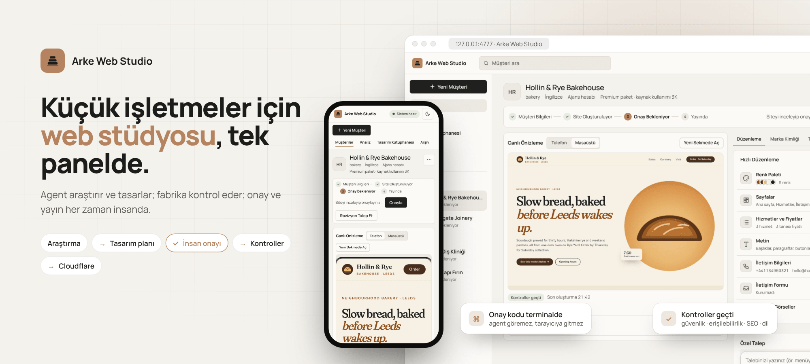
</picture>

<br>


**[Quick start](#quick-start)** · [Screenshots](#screenshots) · [How it works](#how-it-works) · [Security](#security-model) · [Changelog](CHANGELOG.md) · [Roadmap](ROADMAP.md)

</div>

Arke Web Studio is a local control panel plus an MCP server that lets one operator produce, check and publish websites
for small businesses. An AI agent researches the business and proposes a design plan; nothing is built before the
operator approves it, and nothing is published without a human approval code. Sites run on the operator's own
Cloudflare account.

> Proprietary software — see [License](#license). The changelog, roadmap and `docs/` are written in English.

---

## Contents

- [Highlights](#highlights)
- [A client's journey](#a-clients-journey)
- [What it does](#what-it-does)
- [Screenshots](#screenshots)
- [Quick start](#quick-start)
- [How it works](#how-it-works)
- [Usage](#usage)
- [Quality checks](#quality-checks)
- [Site kinds and ready-made parts](#site-kinds-and-ready-made-parts)
- [Personal data (KVKK / GDPR)](#personal-data-kvkk--gdpr)
- [Publishing and Cloudflare](#publishing-and-cloudflare)
- [Working as a team](#working-as-a-team)
- [Updating and moving](#updating-and-moving)
- [Security model](#security-model)
- [Architecture](#architecture)
- [Development](#development)
- [Troubleshooting](#troubleshooting)
- [License](#license)

---

## Highlights

<table>
<tr>
<td width="33%" valign="top">

### 🧭 Plan first, then the site
The agent researches the business, brings back its findings with sources and proposes a **design plan**: concept,
palette, typefaces, pages and a signature motion. Not a single page is written until the operator approves it.

</td>
<td width="33%" valign="top">

### 🔒 Humans approve and publish
Approvals need a **one-time code** shown only in the terminal and are bound to a fingerprint of the content. The agent
cannot approve, publish or touch any account.

</td>
<td width="33%" valign="top">

### 🧪 20+ checks on every build
Security, contrast, SEO, language, currency, legal pages and signature motion, plus phone and desktop screenshots. A
quality report ships with every version.

</td>
</tr>
<tr>
<td valign="top">

### ✏️ Quick Edit
Colours, pages, services and prices, copy, contact details, forms and images: the panel writes simple changes itself
without spending agent credits. Every change is versioned and can be rolled back.

</td>
<td valign="top">

### 🌍 Built for the market
Türkiye, the UK, Ireland, Germany, the Netherlands and the US: language, spelling, currency, date format, legal pages
and the **KVKK / UK GDPR / GDPR** profile all follow the client's country.

</td>
<td valign="top">

### ☁️ Your own Cloudflare account
Preview and live sites run on separate Workers; app sites get D1, R2 and secrets. The free plan is enough, and the
token is stored encrypted.

</td>
</tr>
</table>

---

## A client's journey

<picture>
  <source media="(prefers-color-scheme: dark)" srcset="docs/images/flow-dark.png">
  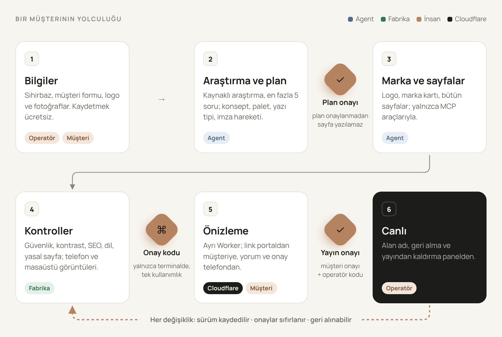
</picture>

The labels on each card show who performs the step; the orange gates are human approvals and cannot be skipped.

---

## What it does

The person using the panel (the **operator** in the rules) adds a client. The agent (Claude Code or Codex) researches
the business and proposes a design plan. Once the operator approves the plan, the agent creates the brand and the site.
The factory checks the site on every build, and after the operator's approval the site is published to the operator's
own Cloudflare account.

| Area | What you get |
| --- | --- |
| **Client intake** | Five-step new-client wizard, questionnaires, client portal (forms and preview link), research notes |
| **Design** | A bespoke brand identity per client (logo, colours, typefaces, signature motion), design-plan approval, three design proposals, a design library |
| **Editing** | Quick Edit for colours (with live contrast measurement), pages, services and prices, copy, contact details, forms, logo and images; **Custom Request** for anything else |
| **Quality** | Security, accessibility and contrast, SEO, link and language-consistency checks on every build; phone and desktop screenshots |
| **Approval** | Approvals come only from a human: the panel asks for a one-time code shown only in the terminal it was started from. Approvals are bound to the content's fingerprint and lapse when it changes |
| **Publishing** | Separate preview and live Workers (preview hidden from search engines), security headers, automatic retry on transient errors, rollback and unpublishing. App sites also get a database (D1), image storage (R2), schema migrations and secrets |
| **Personal data** | A KVKK / UK GDPR / GDPR profile per market: automatic deletion, finding, exporting and deleting a person's data, EU data location, privacy-notice templates |
| **The client's own screen** | On app sites, the client's admin screen: catalogue, inbox and personal-data requests, in Turkish and English |
| **Business tracking** | Quotes, job reports and monthly reports in the client's language (print / PDF), payment and delivery tracking, profit calculation, an Analysis screen (filters, CSV) |
| **Agent budget** | Model choice per package, per-job and monthly limits, Claude Code or Codex per job type |
| **Team and upkeep** | Team sync (Git), in-panel updates, automatic backups, a version snapshot before and after every job, status report |

**The agent's limits:** the agent works only through the factory's MCP tools. It cannot run shell commands, edit files
directly, publish, approve, or reach the Cloudflare account and secrets. It treats text from clients and the web pages it
reads as data, never as instructions.

---

## Screenshots

<p align="center">
<picture>
  <source media="(prefers-color-scheme: dark)" srcset="docs/images/panel-client-dark.png">
  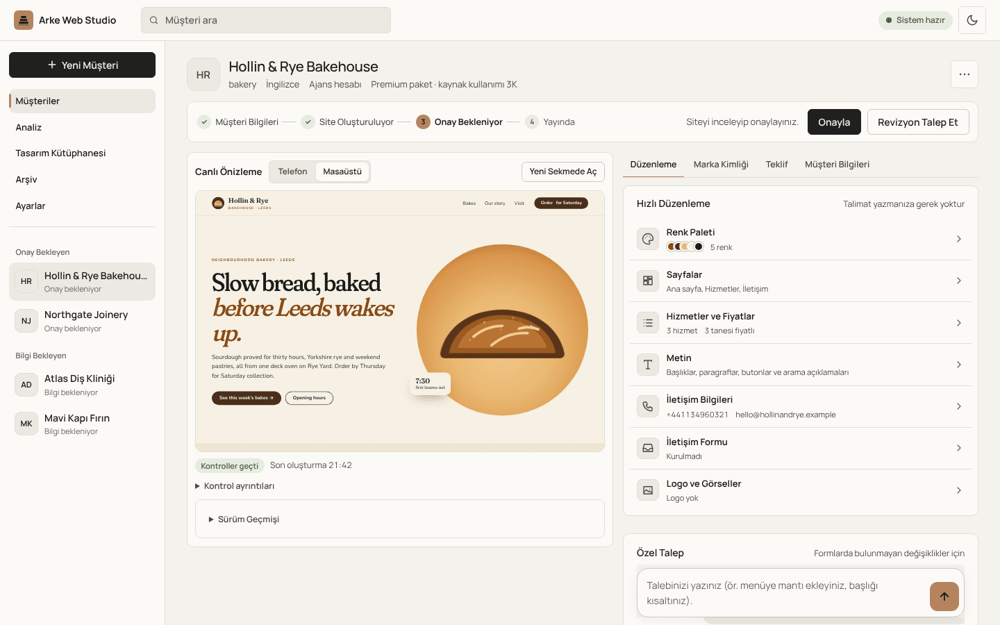
</picture>
<br><sub><b>Client page.</b> Live preview and version history on the left, Quick Edit on the right; the current step and the next approval at the top.</sub>
</p>

<table>
<tr>
<td width="50%" valign="top">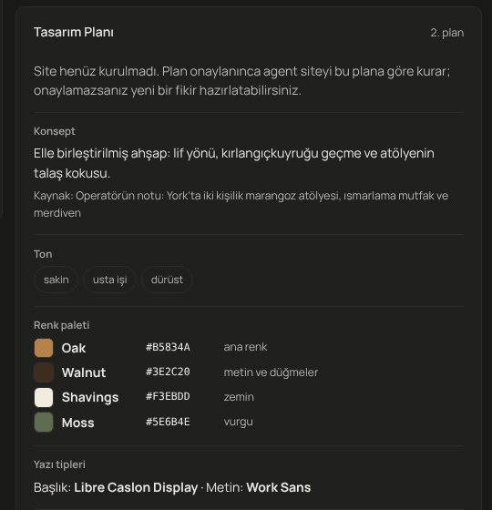<br><sub><b>Design plan.</b> Concept, palette, typefaces, pages and signature motion; no site is written before it is approved.</sub></td>
<td width="50%" valign="top">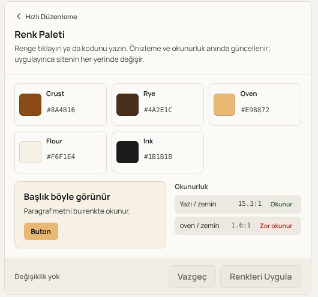<br><sub><b>Colour palette.</b> Preview and contrast ratios update instantly; hard-to-read pairs are flagged.</sub></td>
</tr>
<tr>
<td width="50%" valign="top">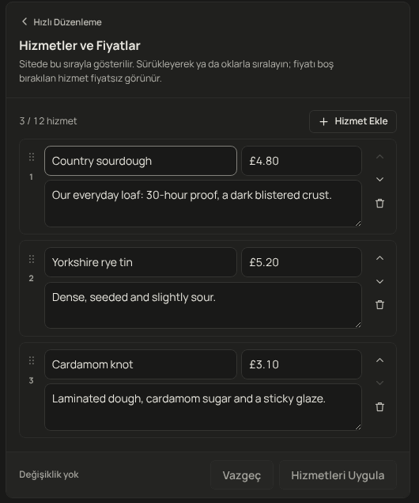<br><sub><b>Services and prices.</b> Drag to reorder, with field validation; the panel writes the change, no agent run needed.</sub></td>
<td width="50%" valign="top">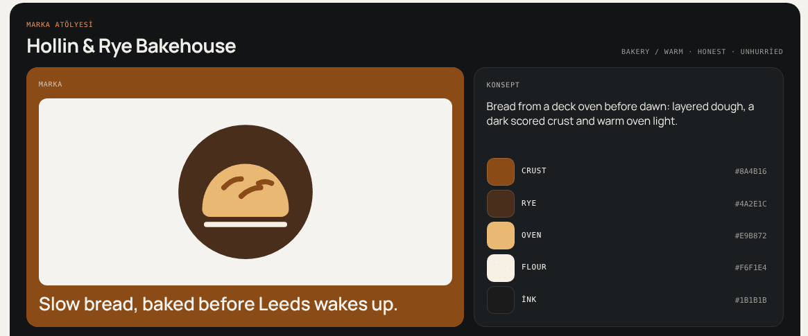<br><sub><b>Brand board.</b> Logo, tagline, colours, live signature motion and typography; sent to the client as a PDF.</sub></td>
</tr>
<tr>
<td width="50%" valign="top">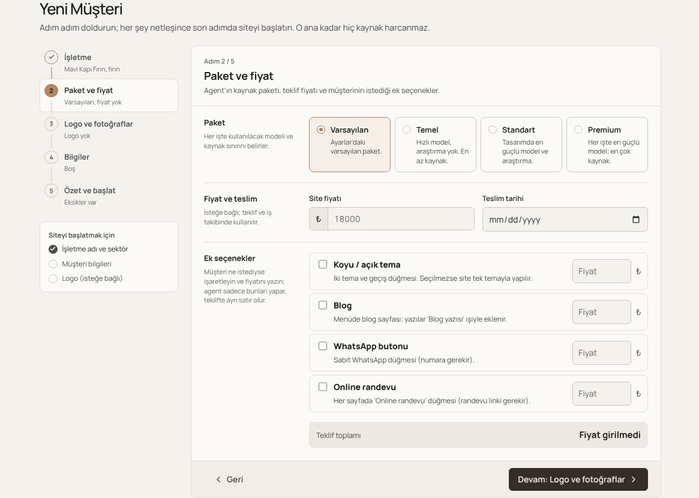<br><sub><b>New client.</b> Five steps; saving is free, credits are spent only on "start building the site".</sub></td>
<td width="50%" valign="top">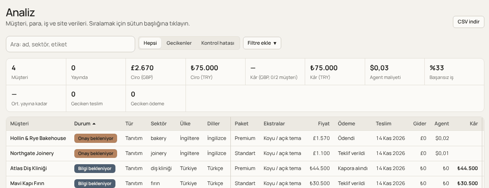<br><sub><b>Analysis.</b> Clients, revenue, costs and agent spend; totals per currency, CSV export.</sub></td>
</tr>
<tr>
<td width="50%" valign="top">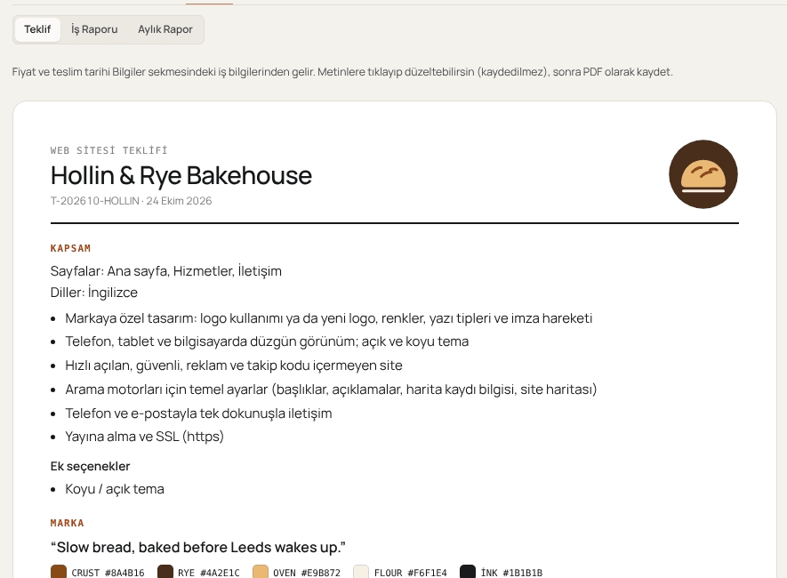<br><sub><b>Quote.</b> Scope, brand and price on one page; print or save as PDF.</sub></td>
<td width="50%" valign="top">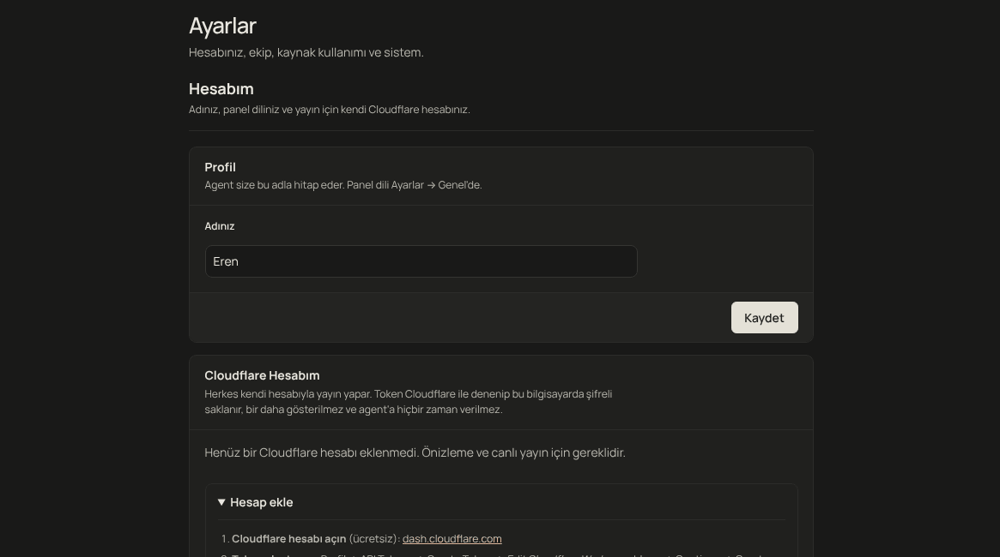<br><sub><b>Settings.</b> Account, team, agent usage, publishing, backups and updates.</sub></td>
</tr>
</table>

<p align="center">
<picture>
  <source media="(prefers-color-scheme: dark)" srcset="docs/images/phones-dark.png">
  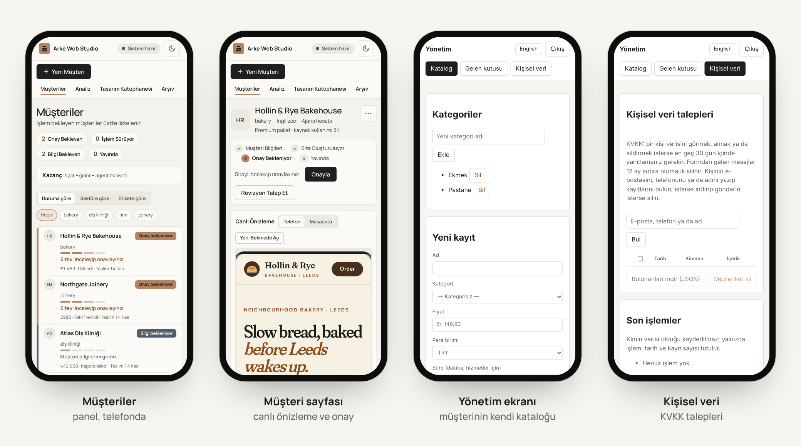
</picture>
<br><sub><b>On the phone.</b> Every panel screen adapts to mobile; the client's admin screen opens in Turkish or English depending on the market.</sub>
</p>

<details>
<summary><b>The panel and the client's admin screen in English</b></summary>
<br>

| English panel | Admin screen (a UK client) |
| --- | --- |
| 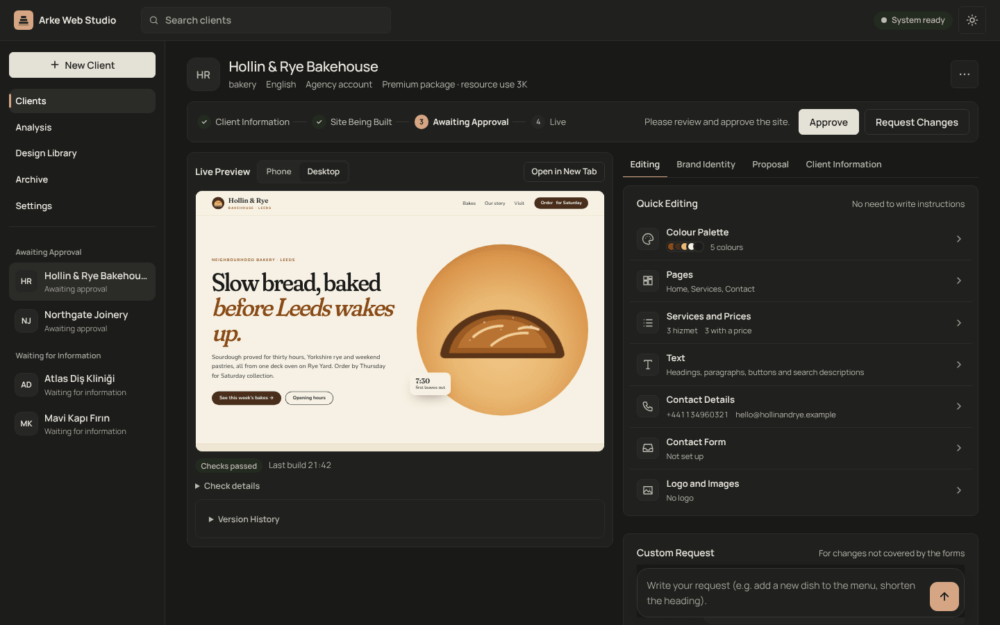 | 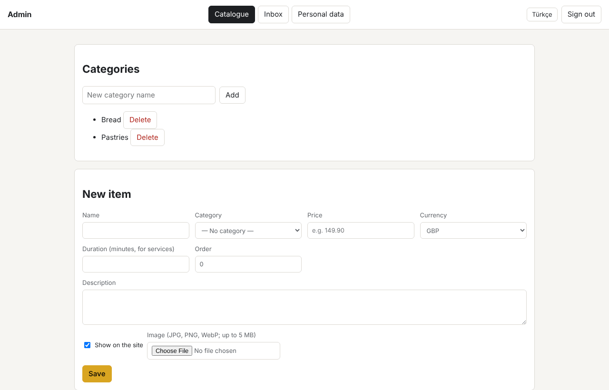 |

</details>

The business and site in the screenshots are fictional (Hollin & Rye Bakehouse). The panel supports dark and light
themes, and the images on this page follow your GitHub theme.

---

## Quick start

### Requirements

| | |
| --- | --- |
| Operating system | Linux, macOS, or **WSL2 (Ubuntu)** on Windows |
| Tools | `git`, **Node.js ≥ 22.12** |
| Agent | [Claude Code](https://docs.claude.com/en/docs/claude-code) (recommended) or the Codex CLI, installed **inside WSL** and signed in |
| Hosting | A free Cloudflare account (asked for on first publish) |

### Installation

The source is visible for reference only; running it requires the owner's written permission (see [License](#license)). With permission, sign in to GitHub first, then run the install script:

```bash
gh auth login
gh repo clone eerenyilmazz/arke-web-studio ~/projects/arke-web-studio
bash ~/projects/arke-web-studio/scripts/install.sh
```

Open a new terminal and start the panel:

```bash
arke-panel
```

The terminal prints the panel address (`http://127.0.0.1:4777/login?key=…`). Open it in your browser; on first launch
you are asked for your name and the panel language.

<details>
<summary><b>What does the install script do?</b></summary>

`scripts/install.sh` is safe to run again: it deletes nothing, installs no system packages, and prints the install
command for anything missing.

1. Checks `git` and the Node version.
2. Uses the current copy when run from inside the repository; otherwise clones into `~/projects/arke-web-studio` (override with `ARKE_HOME`).
3. Runs `scripts/setup-wsl.sh`: creates the `../arke-clients` and `../arke-inbox` folders, a `.claude/settings.local.json` that stops the agent from writing to client folders directly, then `npm ci`, the build, the tests and the design skills.
4. Adds two commands to your shell (`~/.bashrc`, and `~/.zshrc` if present): **`arke-panel`** starts the panel, **`arke-update`** updates it.

Manual install: `npm ci && npm run build && npm test`, then `npm run panel`.

</details>

<details>
<summary><b>Windows notes</b></summary>

- Install everything on WSL's own disk (`~/projects/…`), not under `/mnt/c/…`. The Windows disk is slow and OneDrive sync can corrupt files.
- Install Claude Code inside WSL as well; the sandbox only works that way.
- From Windows, WSL folders are reachable at `\\wsl$\Ubuntu\home\<user>\projects`.
- Files downloaded in the browser land in the Windows Downloads folder: from WSL, `/mnt/c/Users/<user>/Downloads/`.

</details>

### First launch

1. **Profile:** enter your name and the panel language (Türkçe / English) on the home-screen card. The agent addresses you by this name. Change it later under Settings → My Account.
2. **Cloudflare account:** requested on first publish; you can also add it beforehand under Settings → My Account ([Publishing and Cloudflare](#publishing-and-cloudflare)).
3. **Approval code:** the terminal you started the panel from prints a 6-digit code. It is required for every approval; it never reaches the browser or the agent, changes on every start, and locks after 5 wrong attempts.

---

## How it works

<picture>
  <source media="(prefers-color-scheme: dark)" srcset="docs/images/architecture-dark.png">
  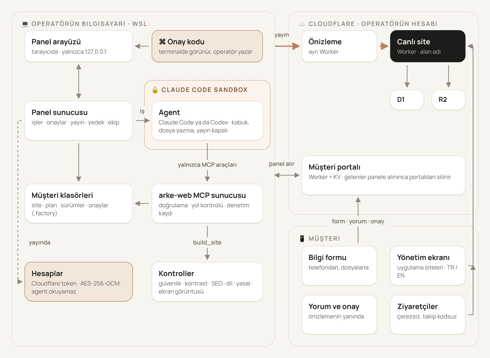
</picture>

- The **panel** starts every job; the agent (`claude -p` or Codex) runs in the Claude Code sandbox with restricted
  permissions and only the `arke-web` MCP tools.
- The **MCP server** validates every write (path, schema, file type) and records it in the audit log; builds and checks
  run here.
- The **panel** snapshots the client before and after every job, so any change can be undone.
- **Accounts** are stored encrypted and decrypted by the panel only at publish time; agent processes cannot see the file.
- The **portal** collects the client's forms, comments and approval; the panel deletes them from the portal once received.
- The rules live in one place: [`AGENTS.md`](AGENTS.md) and [`rules/`](rules/). Agent prompts do not repeat the rules;
  they only say which file to read.

---

## Usage

### New client

The wizard has five steps. The steps and a summary of what has been entered sit on the left, with anything still
missing for the build underneath.

1. **Business:** site kind, name, sector, country and language, hosting.
2. **Package and price:** agent package, price, delivery date, extras and the quote total.
3. **Logo and photos:** drag and drop; without a logo the agent draws a wordmark, and it never invents photos.
4. **Details:** free text from the client; the wizard shows whether it contains a phone number, email, address, opening hours, prices and services.
5. **Summary and start:** saving is free; credits are spent only on "start building the site".

The country sets the language, spelling, currency and legal requirements ([`rules/markets.md`](rules/markets.md)).
Sites default to English, or Turkish in Türkiye; a second language is sold as an extra.

### Research and design plan

The agent first researches the business and strong examples from its sector, brings back what it found with sources,
and asks at most 5 questions. It never invents facts it is unsure of. Before writing any page it saves a **design
plan**: concept, colour palette, typefaces, pages and sections, signature motion (name, timing and reduced-motion
behaviour) with a live preview. Until the plan is approved, no page can be written and the build does not pass.

### Editing

The client page shows a live preview (phone / desktop) and the version history on the left, and four tabs on the right:

| Tab | Contents |
| --- | --- |
| **Editing** | The **Quick Edit** list shows the site as it is today. Clicking a row opens its editor; the bar at the bottom counts pending changes, "Discard" reverts them, and Apply stays disabled when there is nothing to apply or something is invalid. Below it, **Custom Request** handles free-form requests. The panel writes simple changes itself; the rest goes to the agent as a short job. |
| **Brand Identity** | Brand board (logo, tagline, colours, live signature motion, typography), save to library, redesign with the brand |
| **Quote** | Printable quote, job report and monthly report in the client's language (Turkish / English); internal lines can be left out |
| **Client Details** | Job tracking, client links, missing items, copy, images, approval and publishing, questionnaire; on app sites, the client's admin screen |

### Approval and publishing

1. When the site is ready, review it and **Approve** (with the terminal code). This approval covers both copy and appearance.
2. The **preview** is published (`arke-<slug>-preview.<subdomain>.workers.dev`); the link can be sent to the client through the portal.
3. Once the client agrees, give the **production** approval and the site goes live (on its own domain, if there is one).

Any change resets the approvals. A version is saved before and after every job; if the panel closes mid-job, that job's
changes are saved as an "Unsaved changes" version the next time the panel starts. The live site can be rolled back in
seconds with **Revert to previous version**, and it can be unpublished from the panel. On the live site, both actions
are confirmed by typing the client's slug.

### Other screens

- **Analysis:** client, job, cost and site data; filters, totals per currency, CSV.
- **Design Library:** saved designs you liked, reusable as a starting point for new clients.
- **Archive:** clients are never deleted, only moved to `_archive/`.
- **Settings:** on wide screens, opens under "Settings" in the main menu. My Account, General, Team, Agent Usage, Publishing, Backup, Update.

### Command line

| Command | What it does |
| --- | --- |
| `arke-panel` | Starts the panel |
| `arke-update [zip]` | Updates Arke Web Studio |
| `npm run approve -- <slug> <site\|content\|visual\|production>` | Approves from the terminal (`site` = content + visual) |
| `npm run report -- <folder>` | Writes a status report; contains no secrets |
| `npm run restore-backup -- <backup.tar.gz> <new-folder>` | Restores a backup into a new folder; never overwrites existing clients |

The agent can also be used directly in Claude Code: opened in this folder, it finds the `arke-web` tools through
`.mcp.json` and follows the flow in [`AGENTS.md`](AGENTS.md).

---

## Quality checks

`build_site` runs the checks below on every build and writes the result to the client's `quality-report.md`. If there
is an **error**, the site cannot be approved; **warnings** appear in the report and in the panel.

| Group | Checks |
| --- | --- |
| **Inputs** | Config and content schema, content matches across languages, inputs unchanged during the build |
| **Plan and brand** | Design plan approved by the operator; brand identity designed first and used throughout; brand board (tagline, signature motion, typography); no previous client's details left in a design taken from the library |
| **Security** | No external scripts, redirects, trackers or embeds; links work; the form has a recipient |
| **Accessibility** | Contrast of text, buttons and accents; `lang`, headings, `alt` text, no leftover placeholders |
| **Search and sharing** | Structured data (`LocalBusiness`), sitemap, social preview cards, image size and weight |
| **Market** | Prices in the client's currency, the market's legal pages (KVKK notice, Impressum…), company details |
| **Languages** | Every page translated; language links point to the same page in the other language |
| **Fonts** | Google Fonts are downloaded at build time and served from the site, so visitors' browsers never contact Google (a warning if the download fails) |
| **Design** | Impeccable design audit; theme toggle and mobile menu use factory parts; signature motion correct step by step and with reduced motion |
| **Visual check** | Phone and desktop screenshots and frames of the signature motion, which the agent reviews and fixes |

---

## Site kinds and ready-made parts

| Kind | Status | Hosting |
| --- | --- | --- |
| **Showcase site** | available | Static site (Cloudflare Workers) |
| **E-commerce** | coming soon | App: Worker + D1 + R2 |
| **Booking** | coming soon | App |
| **Restaurant and café** | coming soon | App |

The agent designs and places the parts on the page; the **factory supplies** the code of every working part. That code
lives in [`parts/`](parts/) and is ready-made and tested; the agent can neither write nor change it
([`rules/parts.md`](rules/parts.md)).

| Part | What it does |
| --- | --- |
| **Catalogue** | Products, services or menu items with category, price, duration and image, rendered on the site with a template the agent designs. |
| **Inbox** | Messages from the site's forms; optional webhook notification, hidden honeypot field, hourly limit. |
| **Admin screen** | The client's own screen (`site-address/admin`) in Turkish and English: it opens in the market's language (Turkish in Türkiye, English elsewhere), the client can switch with a button, and the choice is remembered; dates and money use the client's country format. 12-hour sessions, lock after 5 failed attempts in 15 minutes, strict CSP, hidden from search engines. The operator sets the password; the panel keeps only its hash. |

Next up are cart and payments (iyzico, PayTR or Stripe), legal pages, a booking calendar and a QR menu
([roadmap](ROADMAP.md)). The panel installs the parts on every app site itself (`app/`, `site/js/arke-parts.js`); a new
version refreshes the part code without touching schema migrations already applied.

---

## Personal data (KVKK / GDPR)

Rules are chosen by the client's **market**, not by the page language ([`src/lib/client/privacy.ts`](src/lib/client/privacy.ts);
sources and decisions in [`docs/privacy.md`](docs/privacy.md)).

| Market | Law | Data location | Response time |
| --- | --- | --- | --- |
| Türkiye | KVKK | Cloudflare default | 30 days |
| United Kingdom | UK GDPR | European Union | 1 month |
| Ireland, Germany, Netherlands | GDPR | European Union | 1 month |
| United States | No federal rule | Cloudflare default | 30 days |

- **Automatic deletion:** form messages are deleted nightly after 12 months; order records are kept for the market's legal retention period.
- **Data-subject requests:** in the admin screen's **Personal data** section, a person is found by email, phone or name, and their records can be downloaded (JSON) or deleted.
- **Logging:** deletions and exports are logged without the person's identity (action, date, count).
- **No third-party requests:** fonts are served from the site itself; no trackers, embedded maps or videos.
- **No IP addresses stored:** rate limits use a site-specific keyed hash of the IP, deleted within a day.
- **EU region:** the database and image storage are placed in the region when first created; the region cannot be changed later.
- **Privacy notice:** the agent fills in the templates in [`rules/privacy.md`](rules/privacy.md) with the client's details. Have the templates reviewed by a lawyer once before selling.

---

## Publishing and Cloudflare

Every operator publishes with **their own Cloudflare account**; the free plan is enough.

1. Cloudflare → Profile → API Tokens → **Create Token** → the *Edit Cloudflare Workers* template.
2. Copy the **Account ID** from the Workers & Pages page; the first time, pick your workers.dev subdomain.
3. In the panel: Settings → My Account → **Save and Test** (or the dialog that opens on first publish).

The token is verified against Cloudflare and stored in `~/.config/arke-web-studio/accounts.json`, encrypted with
**AES-256-GCM**. It is never shown again and never enters backups or reports; agent processes never read the file
(`ARKE_NO_ACCOUNTS=1`). An account supplied through environment variables (`ARKE_CF_MANAGED_API_TOKEN`,
`ARKE_CF_MANAGED_ACCOUNT_ID`) also works; an account saved in the panel takes precedence.

Cloudflare receives a copy of `dist/`; `dist/` itself stays exactly as approved. In the copy:

- Brand files (`brand/brand.json`, the signature-motion demo, design proposals) are removed; the logo stays.
- The preview is hidden from search engines (`X-Robots-Tag: noindex` and a `robots.txt` that blocks everything).
- Security headers are added: HSTS on the live site, `nosniff` and `Referrer-Policy` everywhere, and on showcase sites a
  Content-Security-Policy consistent with the build checks.
- An upload interrupted by a transient network or Cloudflare error is retried once.

Publishing order for app sites:

1. Secrets are checked; if any are missing, nothing is touched.
2. The database and image storage are prepared (separate for preview and live; in the EU region for EU clients).
3. The database is backed up.
4. Schema migrations are applied. A destructive migration runs only after it is confirmed by typing the client's slug.
5. Secrets are uploaded over stdin (never on the command line).
6. The Worker is published and the daily clean-up trigger is set.

---

## Working as a team

Connect the team's private Git repository under Settings → **Team** and press **Sync Now**.

- Changes are recorded under your profile name; the repository is accessed with your own git login (`gh auth login`). The panel stores no passwords.
- Each client lives on its own `clients/<slug>` branch. Syncing pushes your changes, pulls the team's and downloads new clients.
- If two people changed the same client, that client is not synced and a warning appears; changes are never merged by guesswork and none are lost. A client with a running agent job is skipped in that sync.

| Shared | Not shared |
| --- | --- |
| Site details, copy, images, site code | Approvals and build records (everyone approves in their own panel) |
| Design plan, its history, research notes | Cloudflare resources and publish records |
| Site kind, sales tracking | Secrets, the Cloudflare token |
| | App code in `app/` (each panel installs the parts itself) |

---

## Updating and moving

**Updating:** Settings → **Update** → *Check for Updates* → *Update*, or `arke-update` in the terminal. The update runs
`git pull --ff-only`, `npm ci` and a build. It does not start if the install folder has uncommitted changes or an agent
job is running. Restart the panel when it finishes. To roll back, use the `git reset --hard <previous-commit>` command
shown on screen. Clients, settings, accounts, `.claude/settings.local.json`, `vendor/` and `node_modules/` are preserved.

**Installing on another computer:** the panel does not connect to Claude itself; it runs the `claude` command on that
computer for each job. Whatever account Claude Code is signed in with is the one used; the panel never sees that key.

1. WSL2 (Ubuntu), `git`, Node 22 (`nvm install 22`).
2. Install Claude Code inside WSL ([setup](https://docs.claude.com/en/docs/claude-code/setup)) and run `claude` once to sign in.
3. Follow the [installation](#installation) steps.
4. Enter your name in the panel and add the Cloudflare token again. The token is encrypted with each computer's own key and cannot be moved.

Clients do not come along automatically: either connect both computers to the same private repository under Settings →
**Team**, or take a backup on the old computer with Settings → **Backup** → *Back up now* and restore it on the new one
with `npm run restore-backup`.

---

## Security model

**Approvals are human-only.** The agent cannot write `approvals.json`, `.factory/` or `quality-report.md`, and cannot
reach the panel. In the panel, approval requires the one-time code from the terminal. Approvals are bound to the
fingerprint of the content and of the built output; a `dist/` different from the approved one cannot be published.

| The agent **can** | The agent **cannot** |
| --- | --- |
| Save the client's details, copy and images with the `arke-web` tools | Run shell commands or edit files directly |
| Research the web and take notes with sources | Approve, or write `approvals.json`, `.factory/` or `quality-report.md` |
| Save the design plan and write the site once the plan is approved | Write pages before the plan is approved |
| Build the site and read the check report and screenshots | Publish or create clients |
| Ask the operator questions and list open items in its summary | Access the Cloudflare account, the token or any secrets |

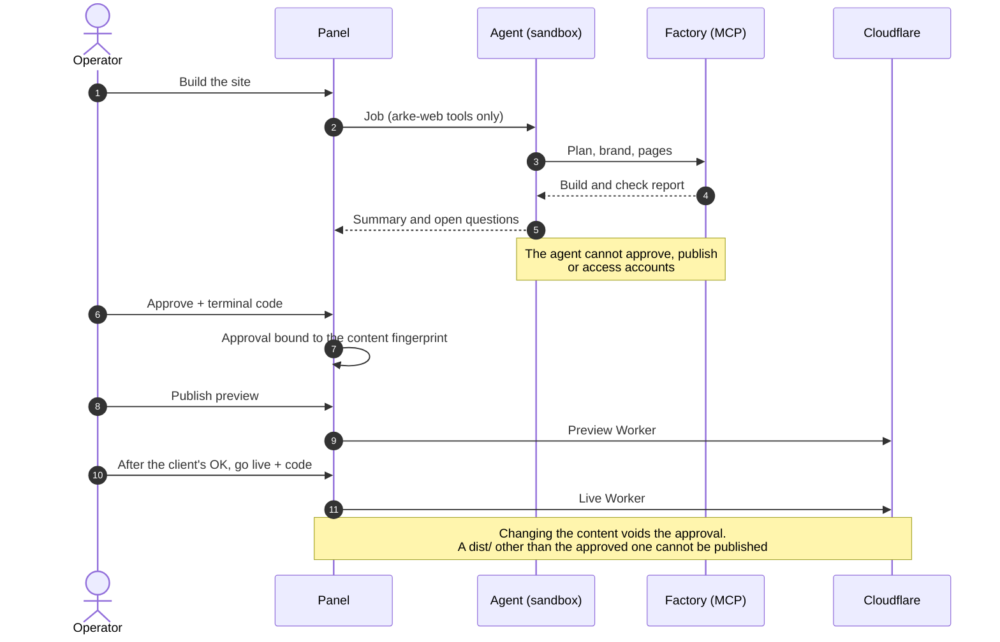

**Agent restrictions**

- Only the `arke-web` tools are enabled; `Bash`, `Edit`, `Write`, publishing and client creation are disabled.
- It runs with `--setting-sources project,local`; Cloudflare variables are removed from its environment.
- It cannot read credential files (`~/.ssh`, `~/.config`, `.env`, git credentials).
- It cannot write pages before the design plan is approved.

**The real boundary: the Claude Code sandbox** ([`.claude/settings.json`](.claude/settings.json)). The agent's commands
can write only to the factory folder and temporary folders, and network access is limited by an allowlist. If the sandbox
is unavailable, Claude Code refuses to start (`failIfUnavailable`). The MCP server, the panel and your terminal run
outside the sandbox.

**Data safety**

- Every path is validated; nothing can escape the client folder, symbolic links included.
- Images are identified by their content; SVGs containing scripts or external references are rejected.
- Commands run without a shell, as argument lists. Secrets appear as `***` in output; every tool call is written to `.factory/audit.log`.

**The sites themselves**

- External scripts, redirects, trackers and embeds are rejected at build time; there are no cookies by default.
- On app sites, passwords are stored with PBKDF2; the session cookie is signed (`HttpOnly`, `Secure`, `SameSite=Strict`).
- The admin screen uses a nonce-based CSP, accepts changes only from the site itself, and rate-limits sign-in and forms.

Text and files from clients are data, not instructions. No site that impersonates a real business is published; tests use
fictional businesses.

---

## Architecture

```
arke-web-studio/                 this repository (the factory)
├── AGENTS.md  CLAUDE.md         the agent's workflow and rules
├── rules/                       single source of the rules: research, design, markets, privacy, SEO, ready-made parts
│   └── products/                page rules per site kind (showcase.md; later ecommerce, booking, restaurant)
├── docs/                        privacy.md (sources), images/, history/
├── src/
│   ├── server.ts  tools/        MCP server and tools
│   ├── lib/core/                infrastructure: paths, files, process execution, errors, accounts (encrypted)
│   ├── lib/client/              client: status, approvals, versions, design plan, questionnaire, privacy profile
│   ├── lib/site/                site: file writes and builds, copy, images, fonts, forms, design knowledge
│   ├── lib/checks/              quality checks: SEO, contrast, languages, currency, signature, screenshots
│   ├── deploy/app.ts            publishing pipeline for app sites (D1, R2, schema, secrets)
│   ├── parts/install.ts         ready-made part installation
│   ├── products/registry.ts     site kinds
│   └── panel/                   panel server, API, jobs, budget, team, updates
├── panel/                       panel UI (framework-free ES modules, i18n, local fonts; one file per screen)
├── parts/                       ready-made parts: app/ (Worker), migrations/, site/
├── portal/                      client portal (Cloudflare Worker)
├── templates/                   legacy template sites
├── scripts/                     install.sh, setup-wsl.sh, update.sh
├── schema/                      JSON schemas generated from Zod
└── tests/                       vitest: unit, security, end-to-end, UI audit; panel/ (API), products/ (kinds)

../arke-clients/<slug>/          one folder and one git history per client
├── site.config.json  content/  assets/  site/     site inputs
├── design-plan.json  research.md                  plan and research
├── app/                                           ready-made parts on app sites
├── dist/  quality-report.md                       built site and check report
└── .factory/                                      approvals and records (panel only)

../arke-inbox/<slug>/            files received from the client
~/.config/arke-web-studio/       accounts and secrets (encrypted)
```

---

## Development

```bash
npm run build        # TypeScript → dist/
npm test             # all tests (ARKE_E2E=off for a fast, browserless run)
npm run test:e2e     # end-to-end tests in a browser
npm run test:click   # clicks every button on every screen and reports errors (ARKE_CLICK_OUT=<folder>)
npm run lint         # Biome
npm run typecheck
npm run schema       # Zod → schema/*.schema.json
```

- TypeScript strict, ESM, zod v4, vitest; the panel is framework-free.
- Changes should be small, reversible and tested; existing APIs and data are preserved.
- UI strings are written in Turkish, with English translations in [`panel/js/i18n-en.js`](panel/js/i18n-en.js); the English panel test checks every screen and editor.
- The UI audit ([`tests/ui-audit.test.ts`](tests/ui-audit.test.ts)) checks every screen in both themes at three widths: contrast, overflow, animation, script errors.
- CI runs lint, type checking, the build and the tests on every push ([`.github/workflows/ci.yml`](.github/workflows/ci.yml)).
- **Language rule:** code, comments, rules (`AGENTS.md`, `rules/`), this README and **commit messages are in English**;
  `CHANGELOG.md`, `ROADMAP.md` and `docs/` are in English too; UI strings are Turkish with English translations. Release commits look like
  `2.5.0: short summary in English`; other work uses `feat(<task>): …`, `fix: …`, `docs: …`, `test: …`.
- **Branches and plans:** work is split into five work plans in ArkeLab; each task is done on a short-lived branch and
  merged into `main` through a PR (`ROADMAP.md` → "Working rules"). Kind-specific code and rules live in their own
  folders (`rules/products/`, `src/products/`, `tests/products/`).

**Cutting a release:** bump the version in `package.json` and `package-lock.json`, add a note to
[`CHANGELOG.md`](CHANGELOG.md), tick the finished step in [`ROADMAP.md`](ROADMAP.md), then commit and push. Git-based
installs update from the panel.

---

## Troubleshooting

| Symptom | Fix |
| --- | --- |
| `npm run panel` → ENOENT | You are not in the factory folder: use `arke-panel` or `cd ~/projects/arke-web-studio` |
| `node: command not found` | Install Node inside WSL: nvm, then `nvm install 22` |
| The agent does not start, sandbox error | `sudo apt install -y bubblewrap socat`; make sure Claude Code is installed inside WSL |
| "No Cloudflare account" on publish | Settings → My Account → Save and Test |
| The update reports "uncommitted changes" | Run `git status` in the install folder and commit or discard the changes. In a folder connected to ArkeLab, files ArkeLab adds also cause this: use a separate copy for development (`ROADMAP.md` → "Development layout") |
| "Fonts served from the site" warning | Google could not be reached during the build, so the site still loads its fonts from Google. Rebuild while online |
| Conflict during team sync | Two people changed that client: one of you pulls first, then sync again |
| The team repository is unreachable | `gh auth login`, then `git ls-remote <url>` |
| Screenshots are not taken | Point to Chrome / Chromium: `export ARKE_BROWSER=/path/to/chrome` |

When asking for support, generate a status report with `npm run report -- ~/`; it contains no secrets.

---

## License

© 2026 Eren Yılmaz. All rights reserved.

Arke Web Studio is not open source. Using, copying, modifying or distributing its code, rules, prompts, templates and
ready-made parts, or running it to serve clients, is prohibited without the owner's written permission. Team members
working under written permission may use it only for the purpose stated in that permission. Full text:
[`LICENSE`](LICENSE). Third-party components come with their own licences: [`THIRD_PARTY.md`](THIRD_PARTY.md).
